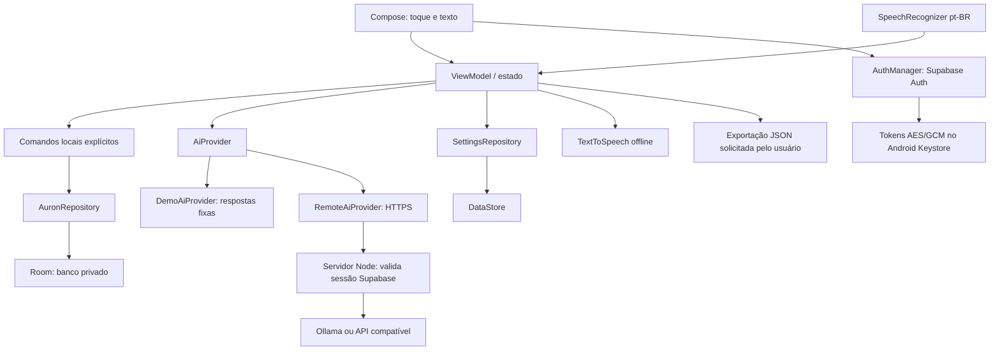

# Arquitetura e decisões

## Escopo

Um módulo Gradle `app`, dividido por responsabilidade. Separar agora dezenas de
módulos aumentaria a manutenção sem benefício proporcional. Interfaces de domínio
permitem extrair módulos Gradle quando existir uma segunda implementação real.

## Escolhas

| Decisão | Motivo |
| --- | --- |
| Kotlin + Compose/Material 3 | Interface nativa adaptável, manutenção e acessibilidade Android |
| minSdk 26 | Suporte a tablets Android 8+, APIs java.time sem compatibilidade extra |
| target/compileSdk 35 | Base reproduzível da Fase 1; atualizar antes de publicar em loja |
| ViewModel + StateFlow | Sobrevive a recriação da Activity e observa dados persistidos |
| Room | SQL validado na compilação, transações e esquema exportado |
| DataStore | Preferências atômicas sem SharedPreferences síncrono |
| Injeção manual | Poucas dependências e fronteiras claras sem DI prematuro |
| Speech APIs / TTS | Serviços oficiais Android, sem API paga incorporada |
| Sem WorkManager ainda | Não há trabalho agendado real na Fase 1; adicionar com lembretes |

## Dados e tempo

Tarefas têm identificador UUID, título, observações, prioridade (0 baixa, 1 normal,
2 alta), prazo ISO opcional, criação e conclusão. Reabrir limpa a conclusão; o
histórico exibe o estado atual das tarefas concluídas, **não um log de auditoria de
todas as alterações**. Excluir uma tarefa também remove seu registro.

Itens da rotina são modelos editáveis. A conclusão tem chave `(itemId, day)` e
snapshot do título/período. Renomear ou excluir o modelo não apaga os snapshots
anteriores. Desmarcar remove a conclusão daquele dia. O dia usa o fuso configurado
no Android; mudar fuso/relógio altera a data operacional, sem reescrever o passado.

Seeds são inseridos uma única vez dentro de transação com metadado de inicialização.
Excluir a rotina ou limpar dados pelo app não restaura seeds automaticamente.
Desinstalar/limpar armazenamento pelo Android inicia uma nova instalação.

Chat e preferências persistem. Memória temporária limita-se a estado de interface
e operação em curso. Memórias persistentes são registros manuais separados do chat,
editáveis e cifrados. Não há extração automática nem busca vetorial. Contexto remoto
inclui apenas histórico e memórias autorizados, com limites de tamanho. Exportação captura coleções locais serializando ações
do ViewModel. Limpar tudo apaga Room e redefine DataStore em sequência: não há
transação distribuída entre ambos; falha de armazenamento é informada.

## IA e automações

`AiProvider` retorna `Success` ou `Unavailable`, declara identidade e se é demo.
O padrão continua `DemoAiProvider`. A opção remota usa `RemoteAiProvider` e o
servidor Node incluído, mediante configuração e consentimento. A chave do modelo
fica exclusivamente no servidor. Há limites de contexto, timeout, cancelamento,
concorrência e frequência. Não há medição monetária: orçamento e retenção devem
ser configurados no serviço escolhido. Consulte [IA](AI-SETUP.md).

Comandos são uma gramática limitada. Só submissões diretas do usuário chegam ao
parser. Texto de documentos, resposta de IA e conteúdo de APIs serão dados, nunca
instruções autorizadas. Comandos internos preservam tarefas/rotinas e navegação.
Na Fase 3, comandos explícitos desconhecidos pelo parser interno podem selecionar
abertura de Activity MAIN/LAUNCHER, painel/leitura de notificações ou preparação de
rascunho. O Activity valida perfil e primeiro plano antes da execução; confirmação
de mensagem só existe em UI separada, nunca em uma resposta do modelo.
NotificationListenerService exige acesso concedido pelo Android, opt-in por perfil
e aplicativos permitidos. Conteúdo e PendingIntents ficam somente em memória,
com limpeza em mudança de perfil/primeiro plano/permissão. Não há executor shell
nem AccessibilityService. Consulte [automações](AUTOMATION.md).

O gateway admite credencial pessoal para o modo sem conta e sessão Supabase para
o modo autenticado. LocalAiAccessStore usa Keystore, arquivo noBackup e associação
à origem HTTPS. O servidor guarda o hash da credencial local; nunca a repassa ao
modelo ou ao Supabase. O acesso remoto ainda depende de servidor/modelo configurado.

## Contas, persistência e isolamento

Na versão 0.2, MIGRATION_1_2 adiciona action nullable às rotinas e as tabelas
memories/daily_readings. Mantém nomes, IDs, conclusões e metadados anteriores.
O perfil local mantém exatamente auron.db e auron_preferences. Uma conta usa
SHA256 da URL do projeto + "|" + ID Supabase para nomes de banco/preferências/chave.
Trocar conta cancela ações e coleta anteriores, limpa estado, rascunhos e eventos.
A UI verifica a identidade antes de apresentar registros; solicitações de IA
verificam identidade antes/depois de obter o token. Exportação se vincula ao perfil
que abriu o seletor de arquivo. Importação local é uma cópia explícita,
transacional, sem sobrescrever registros editados na conta e sem apagar o legado.

Se uma memória não puder ser decifrada, tarefas e rotinas continuam disponíveis;
o módulo de memória mostra erro e permite recarregar. Não há recuperação de chave
perdida, nem exportação silenciosa de conjunto incompleto. A exportação completa
falha com segurança se a memória estiver ilegível.

Autenticação opcional, sem sincronização de tarefas em nuvem. Tokens são cifrados
com AES/GCM e senha nunca é persistida. A configuração contém URLs e chave pública
Supabase; é salva em SharedPreferences no dispatcher IO, com commit verificado.
As preferências de uso continuam DataStore. Veja [configuração](AUTH-SETUP.md).

## Evolução do banco

Preservar `app/schemas`, incrementar versão e fornecer migrações explícitas.
Não usar `fallbackToDestructiveMigration`. Testar migrações e exportação antes de
entregar atualização para usuários com dados reais. Paginação de histórico e
retenção configurável são próximos trabalhos para volumes grandes.

## Integrações da revisão 0.2.1

Auth mantém a identidade usada pelos arquivos Room/DataStore existentes. A nova
cópia manual Supabase é independente: AuronViewModel → SupabaseCloudClient → RPCs
PostgreSQL. O mutex das operações remotas não prende tarefas/rotinas durante rede;
a exportação obtém um snapshot local sob o mutex existente, fora da thread UI.
Trocar perfil cancela operações e descarta respostas da identidade anterior.
RLS, lista administrativa do proprietário e revisão esperada protegem o documento
remoto. Não há restauração, sincronização automática nem envio de memória à IA
por esse caminho. Detalhes: [CLOUD.md](CLOUD.md).

VoiceController continua como adaptador Android. A UI edita um rascunho, permite
ouvir o teste e só persiste em Salvar preferências. Voz, mecanismo, velocidade e
tonalidade pertencem ao DataStore de cada perfil. A abertura usa a imagem oficial
com câmera Compose, decodificação IO e timeout independente do login/rede.
